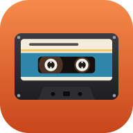
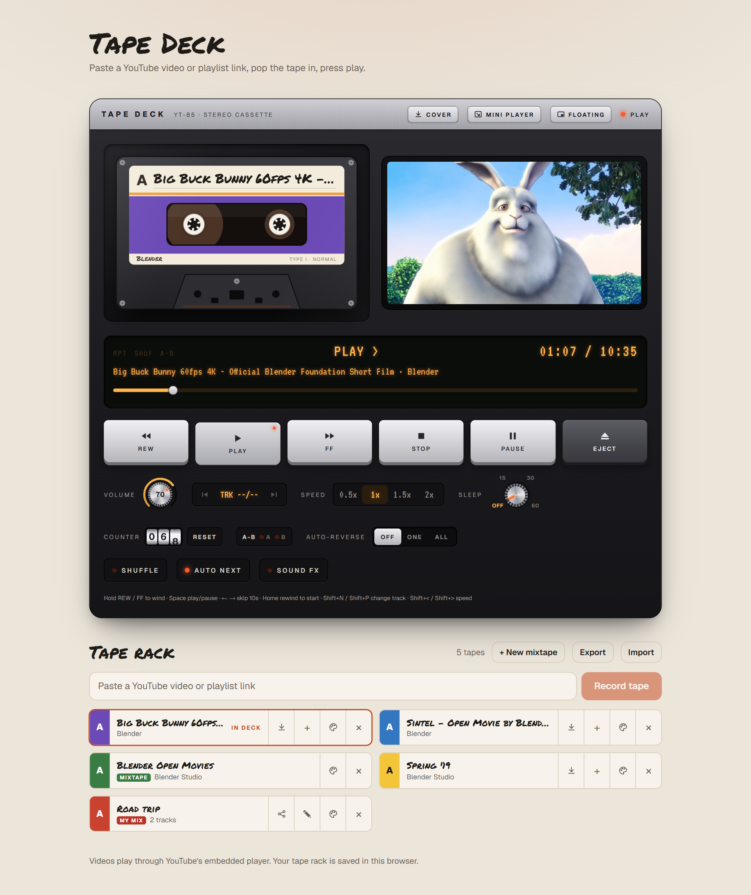
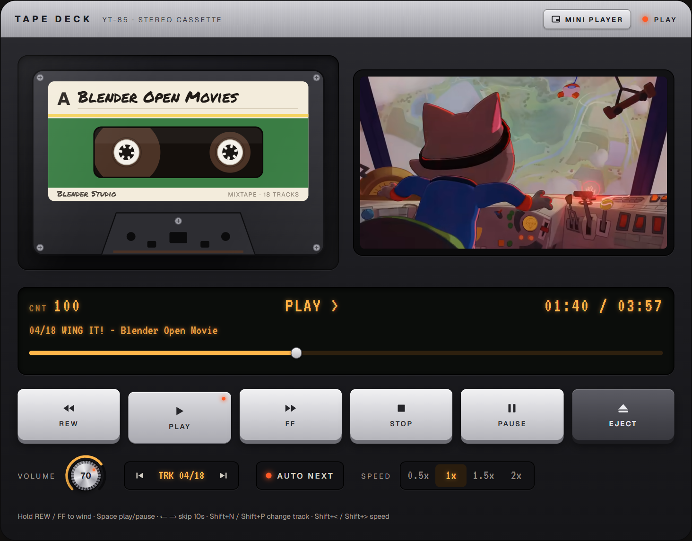
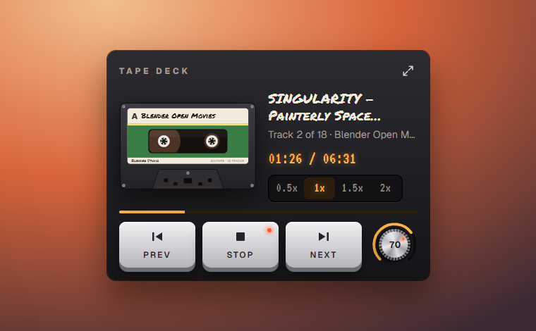
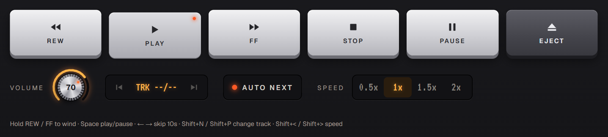

<p align="center">
  
</p>

<h1 align="center">Tape Deck</h1>

<p align="center">A YouTube player dressed up as a retro cassette deck. Paste a YouTube link to record a tape, pop it in, and press play.</p>



## Features

- **Videos and playlists:** a playlist link records a *mixtape* that plays the whole playlist. Skip songs with the TRK buttons or Shift+N / Shift+P. (YouTube Mixes can't be played outside YouTube.)
- **Mini player:** the **MINI PLAYER** button shrinks the app window into a compact player in the bottom-right corner of the screen, with Prev, Play/Stop, Next, speed and volume. The expand button (or Esc) puts it back. This needs the app window opened from the desktop icon, because browser tabs can't resize themselves.
- **Floating player:** the **FLOATING** button opens the same compact player in a separate small window that stays on top of all your other windows. Close it with its ⤢ button or Esc. This needs Chrome or Edge.
- **Volume knob:** hover over it and scroll the mouse wheel. You can also drag it up or down, or use the arrow keys when it's focused.
- **Speed:** play at 0.5x, 1x, 1.5x or 2x from the deck or the mini player (or Shift+&lt; / Shift+&gt;). The speed is remembered.
- **Deck controls:** hold REW / FF to wind through a video (a quick tap skips 10 seconds). The reels spin as the tape plays.

## Screenshots

| Mixtape (dark theme) | Mini player |
| --- | --- |
|  |  |



## Get started

You need [Node.js](https://nodejs.org) and Chrome or Edge.

```bash
git clone https://github.com/YiguangM/youtube-tape-player.git
cd youtube-tape-player
npm install
```

### Open it with one click (Windows)

Run this once to add a **Tape Deck** icon to your Desktop and Start menu:

```powershell
powershell -ExecutionPolicy Bypass -File launcher\install-shortcut.ps1
```

Clicking the icon starts the app and opens it in its own window. Closing the window stops it again. The first launch, and the first launch after any code change, takes a little longer while the app is prepared.

If you move the project folder, run the command again to update the shortcuts. To pin Tape Deck to the taskbar, right-click it in the Start menu and choose **Pin to taskbar**.

### Install it from the browser

The app includes a web app manifest. In Chrome or Edge, use the install button in the address bar (or **⋮ → Cast, save and share → Install page as app**) to add it with its own icon. Once the app is deployed to a public URL, anyone can install it this way.

## Develop

```bash
npm run dev
```

Then open [http://localhost:3000](http://localhost:3000).

| Command         | What it does                         |
| --------------- | ------------------------------------ |
| `npm run dev`   | Development server with live reload  |
| `npm run build` | Production build                     |
| `npm start`     | Serve the production build           |
| `npm run lint`  | Lint the code                        |

### Where things live

- `src/components/TapeDeck.tsx`: the deck, its controls, and the tape rack
- `src/components/Cassette.tsx`: the cassette drawing and spinning reels
- `src/components/MiniPlayer.tsx`, `src/lib/appWindow.ts`: the mini player and window resizing
- `src/components/VolumeKnob.tsx`: the rotary volume knob
- `src/app/api/tape/route.ts`: looks up a video's or playlist's title and checks it can be embedded
- `src/app/manifest.ts`, `src/app/icon.svg`, `public/icons/`: app name and icons
- `launcher/`: the Windows launcher and shortcut installer

## Known limitations

- **Media keys and the Windows media flyout:** Tape Deck publishes what's playing and handles the media keys through the Media Session API, but in Chrome and Edge the YouTube player (which runs in its own iframe) registers a media session too, and the browser sends the system media controls to YouTube's. In practice: **Play/Pause works** (YouTube pauses and the deck follows), but **Next/Previous from the keyboard or the flyout don't change tracks or tapes**, and the flyout shows YouTube's title and artwork. Tested with Chrome and Edge on Windows. The deck's handlers stay in place for browsers that route media keys to the page.

## Credits

The screenshots show footage from *Big Buck Bunny* (Blender Foundation) and *Wing It!* ([Blender Studio](https://studio.blender.org)), both released under Creative Commons Attribution (CC BY) licenses. Videos play through YouTube's embedded player.
